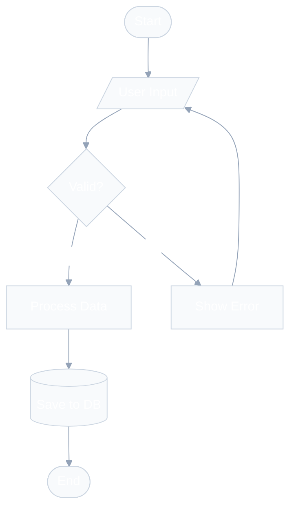
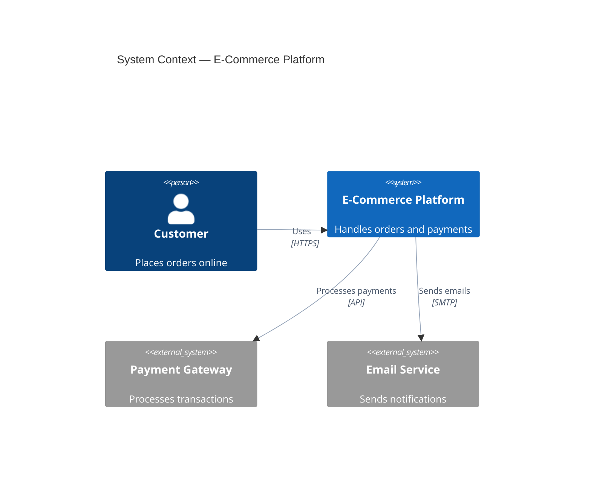

<!-- Package: 00_skills/(tooling)/mermaid-studio; relative command/resource examples resolve from that package or workspace root. -->

## Step 2: Create the Diagram

### 2.1 — Write Mermaid Code

Follow these principles in order of priority:

1. **Elegance first** — every diagram must look professional with init directives and curated colors
2. **Correctness** — valid syntax that renders without errors
3. **Clarity** — meaningful labels, logical flow direction, clear relationships
4. **Simplicity** — under 15 nodes per diagram; split complex systems into multiple
5. **Consistency** — uniform naming (camelCase for IDs, descriptive labels in brackets)

### 2.2 — Structure Rules

```
%% Diagram: [Purpose] | Author: [auto] | Date: [auto]
%%{init: {'theme': 'base', 'themeVariables': { ... }}}%%
[diagramType]
    [content]
```

**CRITICAL:** The `%%{init}` directive MUST go on the very first non-comment line, BEFORE the diagram type declaration. Alternatively, use YAML frontmatter at the absolute start of the file.

**Naming conventions:**

- Node IDs: camelCase, descriptive (`orderService`, not `s1`)
- Labels: natural language in brackets (`[Order Service]`)
- Relationships: action verbs (`"Sends order to"`, `"Reads from"`)

**Layout best practices:**

- `TD` (top-down) for hierarchical flows and processes
- `LR` (left-right) for timelines, pipelines, and sequential processes
- `RL` for right-to-left reading contexts
- Use `subgraph` to group related nodes; name subgraphs meaningfully
- Add `direction` inside subgraphs when needed for different flow

### 2.3 — Quick Reference Examples

**Flowchart (with professional styling):**



For sequence diagram and ERD styling examples, read `references/themes.md`.

**C4 Context (with MANDATORY elegant styling):**



**Architecture (AWS with Iconify icons):**

```mermaid
architecture-beta
    group vpc(logos:aws-vpc)[VPC]

    service api(logos:aws-api-gateway)[API Gateway] in vpc
    service lambda(logos:aws-lambda)[Lambda] in vpc
    service db(logos:aws-dynamodb)[DynamoDB] in vpc
    service s3(logos:aws-s3)[S3 Bucket]

    api:R --> L:lambda
    lambda:R --> L:db
    lambda:B --> T:s3
```



**IMPORTANT:** Architecture-beta diagrams with `logos:*` icons require icon pack registration. When rendering with the render script, use the `--icons logos` flag. If rendering in a markdown viewer that doesn't support icon packs, use the built-in icons (`cloud`, `database`, `disk`, `server`, `internet`) as fallback. Read `references/aws-architecture.md` for the complete icon catalog and rendering instructions.

For comprehensive syntax of ALL diagram types, read `references/diagram-types.md`.
