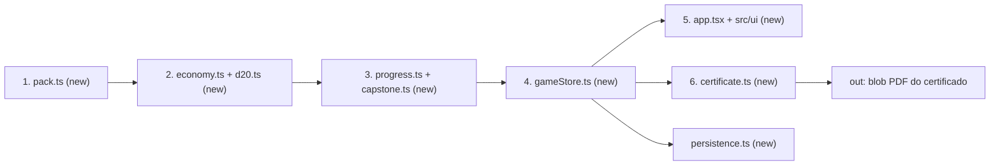
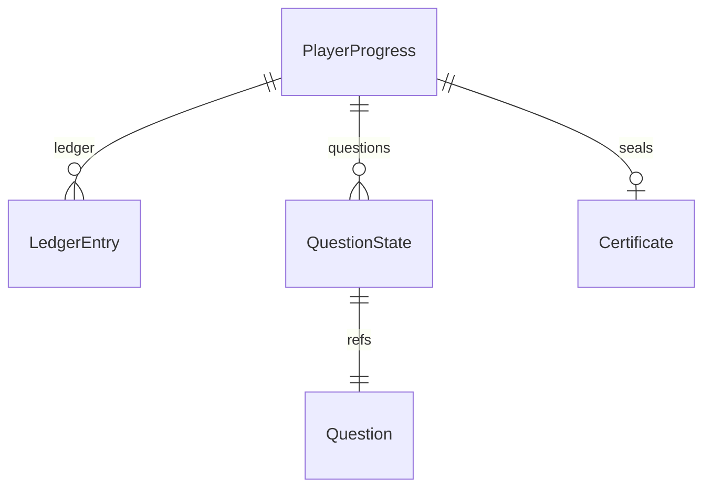
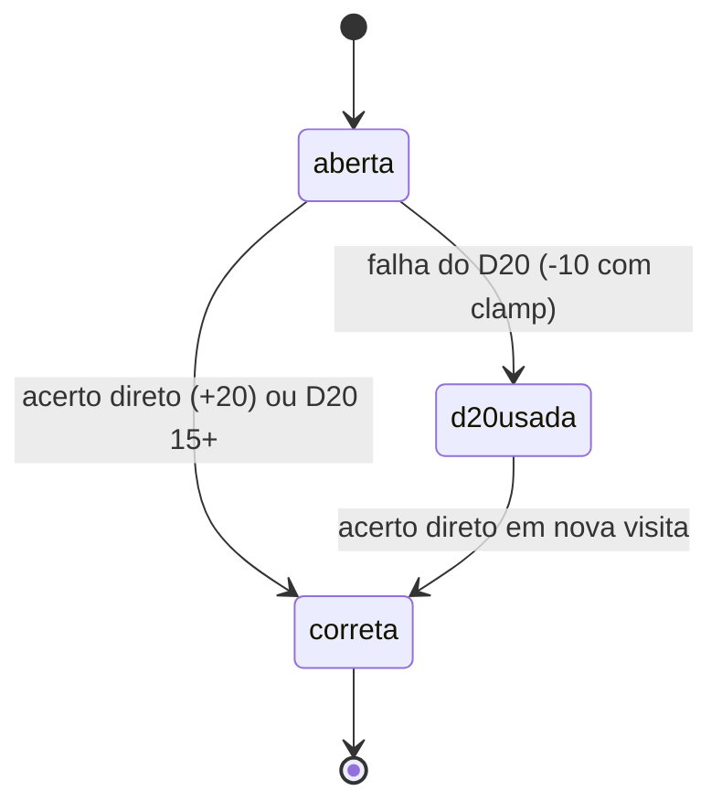

# Formação em IA: RPG de mesa com certificado verificável

## Problem

Alguém querendo virar engenheira(o) de IA hoje estuda em material solto (vídeos, posts, repositórios) sem régua de progresso: não sabe qual foi o próximo conteúdo, se retenção houve, e ao final não consegue **provar** o que aprendeu — certificados emitidos por plataformas não carregam evidência verificável e não avaliam as competências do ofício (arquitetura, treino, manutenção, melhoria, performance, energia, estatística).

Quando isto chegar, a pessoa percorre uma trilha de mesa de 7 reinos com 56 lições, 56 missões e 231 questões juizadas por economia de pontos, passa por uma banca final (Capstone) com oito competências ponderadas e sai com um certificado PDF client-side com código `AIE-AAAA-HASH8` ligado ao SHA-256 do dossiê de evidências — verificável recalculando o hash na mesma página.

## Shape

O jogo reaproveita nada do resto do repositório (projeto aditivo isolado em `10_projetos_estruturantes/ai-engineer-rpg/`); as regras que mudam resultado vivem em funções puras (`src/engine/*`) que os testes alcançam diretamente, e o store React apenas orquestra ações.

1. conteúdo compilado -> `pack.ts` (new) - monta `ContentPack` (7 reinos, capstone, glossário) e índice de questões
2. respostas, dicas e rolagens -> `economy.ts` (new) e `d20.ts` (new) - regras puras (+20, dica 100, D20 limiar 15, penalidade 10 com clamp)
3. trilha e banca -> `progress.ts` (new) e `capstone.ts` (new) - cadeia de desbloqueio e juízo determinístico das 8 rubricas
4. ações do usuário -> `gameStore.ts` (new) - valida, atualiza o ledger e persiste `PlayerProgress` (door 1)
5. telas de mesa -> `App.tsx` (new) e `src/ui` (new) - HUD, mapa SVG 2D, missões, capstone, certificado, glossário e guilda
6. out: certificado - `certificate.ts` (new) gerencia code/hash (door 2) e devolve o blob do PDF baixado

**Changes underneath**

| Front | What changes |
| --- | --- |
| domain | nada no repositório muda de sentido - o jogo é um projeto novo e isolado |
| stored data | só o que o jogo grava: `PlayerProgress` em idb-keyval com espelho localStorage (door 1); nada para migrar |
| readers | o próprio app (hydrate no mount, exportar/importar JSON, emissão do certificado) |

New: `PlayerProgress` com `LedgerEntry`, `QuestionState` e `Certificate` sao as entidades novas gravadas (door 1); `Question` e `Realm` vem do pack somente leitura; door 2 fixa a identidade do `Certificate`. One-way constraints: `aierpg/progress/v1` de estado normalizado (door 1); `AIE-AAAA-HASH8` derivado do SHA-256 do dossiê (door 2).

## Surface

None - nothing consumed outside: aplicação 100% client-side, sem rotas HTTP, sem API consumida e sem autenticação; a única "superfície" é o download do PDF emitido localmente no navegador.

## Landing

| One-way door | Literal shape | Alternative rejected |
| --- | --- | --- |
| Persistência v1 do progresso | chave `aierpg/progress/v1` com `GameState{version:1, playerName, ledger[], questions{qid:{status,via,hintBought,d20Used}}, capstone, certificate}` normalizado por `normalizeProgress` | schema solto sem normalização - rejeitada porque impede migração futura e corrompe o `ledger` após evolução |
| Identidade do certificado | `AIE-{YYYY}-{HASH8}` com hash `SHA-256` (hex 64) do dossiê canônico (JSON ordenado por chave) | UUID aleatório - rejeitado porque não deriva das evidências e não é verificável por recálculo |

## Criteria

### S1: conteúdo e validador do pack (P1)

**Acceptance Criteria**

1. WHEN `validateContentPack(pack)` roda sobre o pack real THEN o validador SHALL retornar zero erros com estatísticas de no mínimo 7 reinos, 36 lições, 30 missões, 120 questões, 20 fontes e 50 termos de glossário
   - pack real (v1.1.0): 7 reinos, 56 lições, 56 missões, 231 questões, 51 fontes, 78 termos -> zero erros
2. IF uma questão tem menos de 3 opções, dica com menos de 8 caracteres ou índice `correct` fora dos limites THEN o validador SHALL registrar erro
3. The pack SHALL somar os pesos JEV dos sete reinos em 1.0 (tolerância 1e-6), trazer oito competências de capstone com pesos somando 1.0 e rubricas 0..4, e dissertação com mínimo de 400 caracteres
4. IF uma fonte tem flag `auto` com confiança menor que 0.7, flag `revisar` fora da faixa 0.5-0.7 ou `checkedAt` ausente THEN o pack real SHALL contrariar o contrato (fontes reais: todos os selos na faixa e com data)

### S2: economia de pontos (P1)

5. WHEN a jogador marca a opção correta THEN o store SHALL registrar +20 pontos no ledger e o XP SHALL somar apenas os deltas positivos
   - 5 acertos -> saldo 100 e XP 100
6. IF a opção marcada está errada THEN o ledger SHALL permanecer inalterado (erro não penaliza)

### S3: D20 de resgate (P1)

7. WHEN o saldo está abaixo de 100 e o jogador rola o D20, então, com valor 15 ou mais, o store SHALL marcar a questão correta com via `d20` e pagar +20; com valor menor que 15, o store SHALL descontar o mínimo entre 10 e o saldo atual (clamp; saldo jamais negativo)
   - saldo 5 -> penalidade -5; saldo 0 -> penalidade -0; saldo 99 -> 89 após falha cheia
8. IF o D20 já foi usado na questão (flag `d20Used`) ou a questão já está correta ou o saldo é 100 ou mais THEN o store SHALL recusar a rolagem retornando null

### S4: cadeia de progresso (P2)

9. WHEN todos os questionIds de toda missão do reino n-1 ficam corretos THEN o mapa SHALL abrir o reino n, a missão SHALL abrir somente com a anterior completa e o Capstone SHALL abrir apenas com os sete reinos completos
   - reino 0 sempre aberto; falta 1 questão -> reino seguinte e banque fechados

### S5: banca do Capstone (P2)

10. WHEN as oito competências são pontuadas em Scores 0..4 e a dissertação atinge o mínimo THEN a banca SHALL aprovar com nota final maior ou igual a 0.85 e nenhuma competência abaixo de 0.50
    - tudo em 4 -> nota 1 e aprovado; competência pesada em 1 -> reprovado; dissertação menor que 400 caracteres -> reprovado; tarefa sem score -> 0 e falha "pendente"; score 9 -> tratado como 4
11. WHILE qualquer competência pontua abaixo de 0.50 THEN a banca SHALL reprovar mesmo com nota final acima de 0.85

### S6: certificado verificável (P2)

12. WHEN o Capstone passa e os 7 reinos estão completos THEN o store SHALL emitir código no formato `AIE-AAAA-HASH8` (8 hex maiúsculos) derivado do SHA-256 do dossiê canônico
13. IF o mesmo dossiê é materializado com ordem de chave diferente THEN o hash SHALL permanecer idêntico (canonicalJson ordena chaves estavelmente) e o SHA-256 de referência (abc -> ba7816bf8f01cfea414140de5dae2223b00361a396177a9cb410ff61f20015ad) SHALL bater
14. WHEN o PDF é renderizado THEN o documento SHALL abrir de volta com 1 página, bytes começando com %PDF, e os metadados SHALL devolver o código do certificado em `getKeywords()` e o hash em `getSubject()`

### S7: store e persistência (P3)

15. WHEN a jogadora submete o Capstone pela UI THEN o estado SHALL guardar o veredito (nota, aprovação, falhas) e a emissão do certificado SHALL ser negada sem Capstone aprovado e reinos completos
16. WHEN o progresso é exportado e importado THEN o estado SHALL voltar idêntico (normalizado, versão 1), e IF o JSON é inválido THEN o import SHALL retornar false sem tocar o estado

### S8: build do jogo (P3)

17. WHEN o build roda THEN o TypeScript SHALL terminar sem erro e o Vite SHALL emitir em `dist/` um `index.html` independente de servidor: script clássico *deferred* (sem `type="module"`/`crossorigin`, com `defer`), caminhos relativos e CSS embutido no chunk, abrível por duplo clique via `file://`

## Out of scope

| Excluded | Why |
| --- | --- |
| Servidor, API ou autenticação | decisão do owner: jogo 100% client-side, progresso só no dispositivo |
| Geração dinâmica de conteúdo (LLM) | pack é autoral fixo v1.1.0 com curadoria JEV; sem geração em runtime |
| E2E de navegador automatizado fora do âmbito aprovado | telas compilam pelo build e interações de store são testadas; revisão visual manual no dev server |
| Assinatura criptográfica (PKI) do PDF | o contrato aprovado é verificação por recálculo de SHA-256, não assinatura |
| Internacionalização (EN) | conteúdo PT-BR com termos EN embutidos, conforme briefing |

## Assumptions

| Assunção | Escolhido | Fundamento | Confirmado? |
| --- | --- | --- | --- |
| Economia de pontos | +20 por acerto; dica 100; D20 liberado só com saldo < 100; >= 15 marca correta; falha desconta 10 com clamp em zero | números ditados pelo dono no briefing | y |
| Pesos JEV por reino | 0.14/0.12/0.13/0.16/0.18/0.21/0.06 | distribuição ponderada por profundidade do conteúdo, aprovada no plano integral | y |
| Capstone | 8 competências ponderadas (0.16/0.14/0.12/0.10/0.14/0.14/0.10/0.10), corte 0.85, mínimo por competência 0.50, dissertação de 400 caracteres | valores fixados no plano aprovado | y |
| Portões de verificação | mutations 3; build `tsc --noEmit` + `vite build`; suíte vitest | definidos pelo dono no plano | y |
| Nome do herói opcional | emissão do certificado cai para "Examinando" sem nome | padrão defensivo de implementação | n |
| Política de entrega | sem commit; mudança fica na working-copy do projeto novo | política declarada pelo owner nesta sessão | y |

**Open questions:** none - todas resolvidas no briefing e no plano aprovado.

## Sources

- Briefing do dono nesta sessão (regras de economia, capstone 0.85/0.50, código AIE, pack mínimo, mutations 3) - aprovado em 2026-11-10
- Plano aprovado do mission - `C:\Users\paulo\.opencode\plan\ai-engineer-rpg-web.md` - slices S1..S8 e portões
