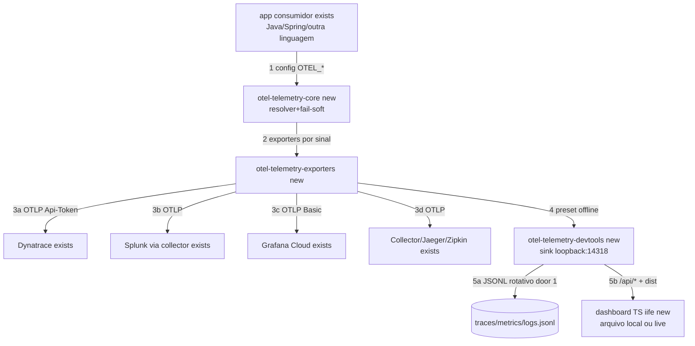

# otel-telemetry-java (v1.0.0)

## Problem

Hoje cada aplicação deste ecossistema teria que montar OpenTelemetry à mão: SDK, exporters, headers proprietários por vendor, batching, appenders de log e, sem Dynatrace/Splunk/Grafana, não existe destino local — apps Java e de outras linguagens ficam sem telemetria. Quem paga: as equipes (integração repetida e propensa a erro) e o operador (fica cego onde não há backend). A fonte (pedido do owner, conversa 2026-11-10) não dá evidência quantitativa.

Quando a biblioteca existir, um app adiciona a dependência e chama um bootstrap de uma linha (ou herda auto-config no Spring), emitindo traces/metrics/logs por OTLP para Dynatrace, Splunk (collector), Grafana Cloud, Collector genérico — ou, sem backend, para o sink local multilíngue, cujo dashboard HTML/TS/JS renderiza os três sinais offline.

## Shape

Reusa o OpenTelemetry Java SDK 1.68.0 (traces/metrics/logs estáveis), appender Logback upstream, bridge Micrometer e os SDKs oficiais das outras linguagens nos presets — nenhum protocolo proprietário é reimplementado. As regras de decisão (precedência de config, presets por sinal, fail-soft, rotação do JSONL) rodam em `otel-telemetry-core` e `otel-telemetry-devtools`, camada coberta por JUnit.

1. app consumidor (Java puro, Spring, ou SDK oficial de outra linguagem via `OTEL_*`) → `otel-telemetry-core` (new) — resolve config (env > sysprop > yaml > builder), escolhe preset, fail-soft
2. `otel-telemetry-core` → `otel-telemetry-exporters` (new) — monta 3 exporters OTLP (traces/metrics/logs), cada um com URL+headers do preset
3. `otel-telemetry-exporters` → backend externo (exists upstream) — Dynatrace (`Api-Token`), Splunk via collector, Grafana Cloud (Basic), Collector genérico 4317/4318
4. `otel-telemetry-exporters` → `otel-telemetry-devtools` (new) — preset `offline`: OTLP/HTTP para o sink local
5. `otel-telemetry-devtools` (new) — sink (HttpServer do JDK) decodifica OTLP → `traces/metrics/logs.jsonl` rotativos e serve `dashboard/dist` (Vite iife) + `/api/*`; out: dashboard live renderiza os três sinais

**Changes underneath**

| Front | What changes |
| --- | --- |
| stored data | nenhum esquema relacional; artefatos JSONL rotativos por sinal (door 1) |
| readers | dashboard `/api/*` lê os JSONL; presets-multilingue documentam o mesmo contrato para apps não-Java |

Data: none - sem entidade relacional; os JSONL são artefatos rotativos, não banco.

## Surface

| Route | In | Out | Status | Who |
| --- | --- | --- | --- | --- |
| `POST /v1/traces` (OTLP/HTTP protobuf, sink) | corpo OTLP | `{"partialSuccess":{}}` | 200, 400, 503, 403 | processos no host (loopback default); fora do host sem token → 403 |
| `POST /v1/metrics` (OTLP/HTTP protobuf, sink) | corpo OTLP | `{"partialSuccess":{}}` | 200, 400, 503, 403 | processos no host; fora do host sem token → 403 |
| `POST /v1/logs` (OTLP/HTTP protobuf, sink) | corpo OTLP | `{"partialSuccess":{}}` | 200, 400, 503, 403 | processos no host; fora do host sem token → 403 |
| `GET /api/traces` (idem `/api/metrics`, `/api/logs`; query `since`,`limit`) | query | JSON paginado | 200, 400, 403 | dashboard servido pelo sink (CORS restrito); origem estranha → 403 |
| `GET /api/health` | - | `{"ok":true}` | 200 | anyone local |
| `GET /` (dashboard estático) | - | `index.html` | 200 | anyone local |

## Landing

| One-way door | Literal shape | Alternative rejected |
| --- | --- | --- |
| Formato do armazenamento do sink | `traces.jsonl` / `metrics.jsonl` / `logs.jsonl`; uma linha = requisição OTLP decodificada em OTLP JSON (`ExportTraceServiceRequest`, etc.) | envelope próprio `{kind,payload}` — segunda normalização sem ganho para o dashboard (AD-004) |
| Contrato de configuração | `OTEL_*` env > sysprop `otel.*` > `oteltelemetry.yaml` > builder; credenciais exclusivamente por runtime env | builder-only — perde interop com operadores/K8s dos vendors (AD-003) |
| Coordenadas e bytecode | groupId `com.aeos.telemetry`, artefatos `otel-telemetry-*`, bytecode Java 21 (toolchain JDK 25) | release 25 — fecha consumidores 17/21 (J-F1, AD-002) |

- Nothing else in this change is hard to reverse

## Criteria

### S1: Bootstrap resolve config e instala a telemetria (P1)

**Acceptance Criteria**

1. WHEN `TelemetryBootstrap.start()` recebe `serviceName` THEN the system SHALL ativar SDK com `resource.service.name` igual ao valor e exporters OTLP apontando para o endpoint configurado
2. IF o endpoint configurado é inválido (URL malformada) THEN the system SHALL ativar SDK no-op e registrar diagnóstico com a causa, sem lançar exceção ao app
3. IF nenhum backend/preset é configurado THEN the system SHALL usar o preset `offline` (sink local) como default
4. WHILE a telemetria está instalada, WHEN o app chama `Telemetry.shutdown()` THEN the system SHALL fazer flush (timeout 5 s) e liberar os exporters sem perder registros pendentes no stub

### S2: Presets por sinal e segredos (P1)

**Acceptance Criteria**

5. WHEN o preset `dynatrace` está ativo THEN cada exporter SHALL apontar para `{base}/api/v2/otlp/v1/{traces,metrics,logs}` com header `Api-Token` lido do runtime env — status de verificação rotulado (gate J1)
6. WHEN o preset `grafana` está ativo THEN os exporters SHALL usar autenticação Basic sobre o gateway OTLP com credenciais de runtime env
7. WHEN o preset `splunk` ou `otelcol` está ativo THEN os exporters SHALL usar OTLP padrão (gRPC 4317 / HTTP 4318) sem header proprietário
8. IF a credencial do preset está ausente THEN the system SHALL ativar fail-soft (diagnóstico sem valor da credencial) e NUNCA imprimir o token no log
   - `OTEL_DYNATRACE_TOKEN` ausente → no-op com causa "credencial ausente"; token presente e URL malformada → no-op com causa "URL"; nenhum caso imprime o valor

### S3: Logs e métricas do app (P2)

**Acceptance Criteria**

9. WHEN o app loga via Logback THEN the system SHALL exportar o record como log OTLP com severity e, quando em span ativo, trace/span id associados
10. WHEN um meter Micrometer é criado THEN the system SHALL exportá-lo como métrica OTLP pela bridge upstream

### S4: Spring Boot (P2)

**Acceptance Criteria**

11. WHERE Spring Boot (4.1/3.5) está no classpath THEN `otel-telemetry-spring-boot-starter` SHALL autoconfigurar a telemetria a partir de properties `oteltelemetry.*` sem beans adicionais no app
12. IF Spring Boot está ausente THEN o starter SHALL permanecer inerte (auto-config condicional)

### S5: Sink offline (P1)

**Acceptance Criteria**

13. WHEN um payload OTLP válido chega em `POST /v1/traces` THEN o sink SHALL gravar uma linha JSONL em `traces.jsonl` e responder 200
14. IF o payload é inválido THEN the system SHALL responder 400 com mensagem de causa sem corromper o arquivo existente
15. WHILE o JSONL ativo excede o teto (tamanho ou idade) THEN o sink SHALL rotacionar para `*.1.jsonl` e limitar o número de arquivos mantidos
16. WHEN o sink inicia THEN the system SHALL bind em `127.0.0.1:14318` por padrão (host/porta/token por config)
17. IF o sink está `disabled` por config THEN `POST /v1/traces` SHALL responder 503 sem gravar

### S6: Dashboard (P1)

**Acceptance Criteria**

18. WHEN o dashboard abre no sink THEN the system SHALL listar traces, logs e métricas recentes via `/api/*` e desenhar métricas em modo delta
19. WHEN o dashboard é aberto pelo navegador como arquivo local (duplo clique no `dist/index.html`) THEN the system SHALL carregar JSONL por drag-and-drop e renderizar os mesmos painéis (build iife, caminhos relativos)
20. IF um arquivo JSONL é enorme THEN the system SHALL carregar janela limitada (cap configurado) sem travar a página

### S7: Presets multilíngue e exemplos (P2)

**Acceptance Criteria**

21. WHEN um app Node/TS usa o SDK oficial com `OTEL_EXPORTER_OTLP_ENDPOINT` no sink THEN o dashboard SHALL renderizar os dados desse app no e2e (Python/Go/.NET/Rust seguem o mesmo contrato documentado; Rust com status experimental AD-008)
22. WHEN um desenvolvedor copia o exemplo (Spring ou Java puro) THEN the system SHALL emitir telemetria com no máximo uma linha de bootstrap (o gerador de carga incluso faz o dashboard mostrar dados)

## Out of scope

| Excluded | Why |
| --- | --- |
| Instrumentação automática de frameworks (agent) | reuso do javaagent upstream 2.33.1 documentado no README |
| Publicação no Maven Central | sem organização/repos definidos pelo owner |
| Persistência além do JSONL rotativo (SQLite, histórico IndexedDB) | v1; door 4 cobre o formato, storage evolui depois |
| mTLS/keystore por preset | HTTPS do preset cobre; necessidade não evidenciada |
| TLS customizado no sink | loopback local; token cobre autenticação mínima |
| Verificação de runtime nos SDKs Python/Go/.NET/Rust nesta sessão | sem ambientes provisionados; contrato documentado é o entregável (AD-008/AD-009) |

## Assumptions

| Assumption | Chosen default | Rationale | Confirmed? |
| --- | --- | --- | --- |
| Versão Spring Boot alvo do starter | 4.1.2 (nota de compat 3.5) | 4.1.2 estável no Maven Central (verificado 2026-11-10) | y — user delegated na conversa |
| Porta default do sink | 14318 | evita colisão com Collector real em 4318 (J-F3) | y — plano v3 aprovado |
| Preset Rust | documentado como experimental | SDK crates 0.33.1 ainda 0.x | y — plano v3 |
| URLs/auth de Dynatrace/Grafana/Splunk | hipóteses do plano v3, rotuladas NÃO VERIFICADO até doc real (gate J1) | DO NOT INVENT | n — controlado pela rotulagem (AD-009) |

**Open questions:** none — a incerteza dos endpoints é tratada por rotulagem obrigatória, não por invenção.

## Differences from the source

None - projeto novo, sem fonte visual.

## Sources

- Pedido do owner (conversa, 2026-11-10) - binding - escopo, linguagens, destinos, fallback offline
- Plano v3 da conversa (The-Judge/The-Fool, decisões do owner) - binding - J-F1..J-F7, baseline, localização
- Maven Central / Adoptium / npm / crates.io (metadados de 2026-11-10) - non-binding - pins de versão
