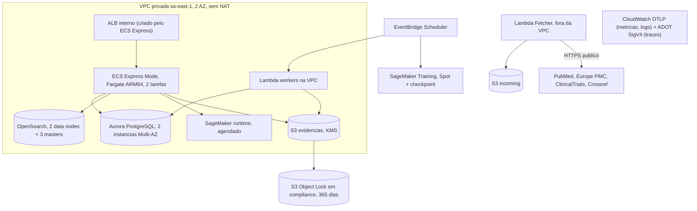

# AWS de uso exclusivo: AIHealthResearch

Status: modelo de arquitetura, não aprovação de produção. O próprio projeto diz que produção médica está bloqueada até existirem evidências externas (`docs/PRODUCTION_PLAN.md`, `README.md`). Nada foi implantado. Modelos lidos pelo MCP:

- `cloud-architecture/models/aws/aihealthresearch.as-is.model.json` (o CloudFormation atual);
- `cloud-architecture/models/aws/aihealthresearch.target.model.json` (o alvo proposto).

## 1. Fronteiras que a arquitetura precisa respeitar

Do `docs/ARCHITECTURE.md` do próprio projeto:

1. **Nenhum endpoint externo de LLM, embedding ou juiz** em workloads governados. Por isso, Amazon Bedrock e equivalentes ficam fora do desenho (regra AWS-008 e pitfall P-AWS-06). A chave TypeSafe é recusada na inicialização.
2. Sem diagnóstico, prescrição ou alegação de cura.
3. Todo dado treinável tem proveniência, licença e revisão.

Dados: literatura científica pública e curadoria institucional. Sem prontuário (ARCHITECTURE.md e THREAT_MODEL.md). Ainda assim, há **dado pessoal** em identidades (Cognito) e em tenants, por isso a classificação é `personal`.

## 2. O que o CloudFormation atual faz (fatos verificados)

| Achado | Evidência | Efeito |
| --- | --- | --- |
| 9 endpoints de interface x 2 AZ, sem NAT | `infra/render_stack.py` (loop de endpoints) | Custo fixo de hora em cada AZ (AWS-003) |
| Endpoint SageMaker com `InitialInstanceCount: 2`, sempre ligado; `ModelInstanceType` sem padrão | `infra/workloads.json` (EndpointConfig), `render_stack.py` | Maior custo do desenho (AWS-005). A instância precisa ser escolhida por decisão |
| API em Fargate x86_64 (2 vCPU, 8 GB, 2 tarefas) | `render_stack.py` (TaskDefinition) | ARM64 custa cerca de 20% menos (AWS-015) |
| Lambda `Fetcher` sem `VpcConfig` | `render_stack.py` | Saída pública para as APIs científicas, por desenho; coerente com a quarentena |
| Bucket de auditoria com Object Lock em **GOVERNANCE** de 365 dias | `infra/foundation.json` (ObjectLockConfiguration) | Quem tem `s3:BypassGovernanceRetention` remove a retenção (AWS-017) |
| Aurora PostgreSQL com 2 instâncias `db.r6g.large`, proteção contra exclusão, backup de 35 dias | `render_stack.py` (DBCluster) | Conforme a produção (AWS-011 ok) |
| OpenSearch com 2 data nodes, 3 dedicated masters, gp3 de 100 GB | `render_stack.py` (ClusterConfig) | Conforme a recomendação da AWS (AWS-004 ok) |
| Logs com retenção de 90 dias | `render_stack.py` (LogGroup) | Ok; o custo de ingestão é a alavanca |

## 3. Cenários de custo (sa-east-1, preços de lista do snapshot de 2026-11-14)

| Cenário | Total mensal | O que muda |
| --- | --- | --- |
| **As-is** (CFN como está) | **US$ 6.046,85** | Endpoint sempre ligado com 2 instâncias ml.g5.xlarge (US$ 3.495,24) |
| **Alvo** | **US$ 2.735,52** | Agenda de inferência (1 instância, 8 h x 22 dias); Spot com checkpoint no treino (fator 0,3); Fargate ARM64 |
| Diferença | **US$ 3.311,33 (54,8%)** | — |

Divisão do cenário as-is: endpoint de inferência 57,8%; OpenSearch 14,6%; Aurora 13,3%; VPC endpoints 4,6%; Fargate x86 4,8%; treino 4,2%; ALB 0,5%; demais 0,2%.

Divisão do alvo: Aurora 29,4%; OpenSearch 32,2%; inferência agendada 15,4%; VPC endpoints 10,1%; Fargate ARM64 8,6%; treino Spot 2,8%; ALB 1,2%; demais 0,4%.

Premissas (todas editáveis no modelo JSON):

- ml.g5.xlarge: o template não define o tipo; usei g5.xlarge como referência de GPU de 24 GB.
- Treino: 4 h/dia x 30 dias, teto da janela de 14.400 s do PRODUCTION_PLAN.
- Agenda de inferência: 8 h x 22 dias (premissa; validar com logs reais de uso).
- Spot: fator 0,3 do preço sob demanda (desconto de 70%). A AWS diz "até 90%"; 70% é planejamento conservador.
- 100 GB de Aurora e 100 GB de S3; 5 GB/mês de logs; 5 segredos; 1 LCU constante no ALB.

Não precificados (fora dos totais): KMS, Cognito, Lambda, EventBridge, SQS, ECR, armazenamento de logs, transferência de saída, NAT (não existe neste desenho).

**Lever B3 (fora do alvo, exige benchmark)**: Aurora Serverless v2 com 0,5 ACU mínimo em 2 instâncias custaria cerca de US$ 183/mês contra US$ 803 do provisionado. Só entra depois de medir a carga real e a latência de cada consulta.

## 4. Arquitetura alvo

Contas (AWS Organizations): `aihr-staging`, `aihr-prod` e `aihr-audit` (Object Lock, conta separada, como o plano de produção pede). Não há conta compartilhada com outros projetos.

## 5. Decisões que dependem do dono (ADR)

1. **Object Lock em compliance** (AWS-017): irreversível no período de 365 dias; só se pode apagar a conta. Recomendo, mas é decisão de governança.
2. **Janela de inferência**: 8 h x 22 dias é premissa. Se o uso for 24 h, o custo do endpoint sobe; se for intermitente de verdade, o async com scale-to-zero só serve se o p95 for relaxado (hoje 15 s).
3. **Região**: sa-east-1 pela residência; us-east-1 custaria menos (1,6 a 2,1 vezes de diferença nos preços verificados).
4. **ARM64**: exige imagem multi-arquitetura. O Dockerfile base é `python:3.12.14-slim` (imagem oficial, multi-arquitetura). Falta testar as dependências nativas, sobretudo as de treino.
5. **Endpoints de interface**: os 9 são mantidos. Cada um pode ser removido se a carga não usar o serviço; cada remoção economiza cerca de US$ 30,7/mês em dois AZ.
6. **Traces**: sink local na porta 14318 vai para o agente CloudWatch (padrão 4318); traces com SigV4 (bearer não serve para traces).

## 6. Riscos e lacunas

- **Produção médica bloqueada** pelo próprio projeto (evidência científica, revisão independente, benchmark). Esta arquitetura não resolve isso.
- **Benchmark ausente**: p95 de 15 s e RAG extrativo ainda não foram medidos; o modelo usa essas metas como restrição.
- **SSE no ALB**: timeout e keepalive precisam de teste de carga (não verificado no dossiê).
- **Duas cópias do repositório**: existe `E:\Github\AIHealthResearch` além de `02_repositorios/AIHealthResearch`. Este modelo usa a segunda (HEAD `5878719f`, árvore limpa). A outra não foi analisada.
- **JEV não entra no AIHealthResearch**: o próprio projeto rejeita chave TypeSafe no boot. Nenhum dado do projeto foi enviado ao JEV nesta missão.
