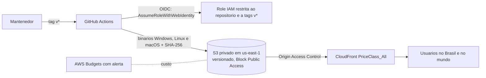

# AWS de uso exclusivo: MyDigitalBuddy

Status: modelo de arquitetura. Nada foi implantado. Modelo lido pelo MCP: `cloud-architecture/models/aws/mydigitalbuddy.model.json`.

## 1. O que o produto exige da nuvem

O MyDigitalBuddy é um companheiro de área de trabalho em Rust. Não tem cliente HTTP nem telemetria (`Cargo.toml` sem crate de rede; README e PRIVACIDADE.md). Por isso, **não há backend a hospedar**. A nuvem serve para:

1. distribuir binários e somas de verificação (`.exe`, Linux, macOS);
2. automatizar a publicação a partir de tags, sem chaves estáticas;
3. controlar custo, com alerta.

Qualquer serviço de coleta de uso violaria o contrato de privacidade. O MCP reprova esse desenho (regra AWS-016).

## 2. Arquitetura

| Componente | Escolha | Por que |
| --- | --- | --- |
| Armazenamento | S3 privado, us-east-1, versionado | Armazenamento mais barato (US$ 0,023/GB-mês contra US$ 0,0405 em sa-east-1). Binários não têm dado pessoal. |
| Distribuição | CloudFront PriceClass_All | Único nível que inclui a América do Sul. Free tier: 1 TB e 10 milhões de requisições/mês, sempre gratuitos. |
| Acesso ao bucket | OAC; Block Public Access | Sem URL pública do bucket. |
| CI | GitHub OIDC; `sub` restrito a `repo:paulosantanna/MyDigitalBuddy:ref:refs/tags/v*` | Sem chave estática. A trust policy precisa restringir `sub`. |
| Conta | `mydigitalbuddy-release` em OU Projects, com SCP de regiões e sem usuários IAM de longo prazo | Isolamento de custo e de acesso. |
| Custo | AWS Budgets com alerta | Controle de gasto. |
| Assinatura Windows | **fora da nuvem** | Artifact Signing não cobre publicador individual no Brasil (verificado). OV de CA custa US$ 150 a 300 por ano (Microsoft). |

## 3. Custo mensal

| Item | Premissa | Valor |
| --- | --- | --- |
| S3 Standard (us-east-1) | 2 GB/mês | US$ 0,05 |
| CloudFront | dentro do free tier | US$ 0,00 |
| OIDC, IAM | sem cobrança | US$ 0,00 |
| **Total medido** | | **≈ US$ 0,05/mês** |
| Não verificado | Route 53 (zona hospedada, se houver domínio próprio), AWS Budgets, transferência acima do free tier | a verificar |

## 4. Decisões

- **D1**: nenhum backend. Mudar isso exige mudar a privacidade do produto (decisão do dono).
- **D2**: origem em us-east-1 pela diferença de preço do armazenamento; a residência não se aplica a binários públicos.
- **D3**: assinatura Windows fora da nuvem até decidir o certificado (OV ou hardware token).
- **D4**: publicação só por tag `v*`, com checksum SHA-256 e, se desejado, atestação de build do GitHub.

## 5. Lacunas

- O pacote macOS precisa de notarização da Apple, que não é coberta por esta arquitetura.
- Não há métrica de download. Isso é coerente com a privacidade; medir por logs do CloudFront exigiria decisão explícita.
