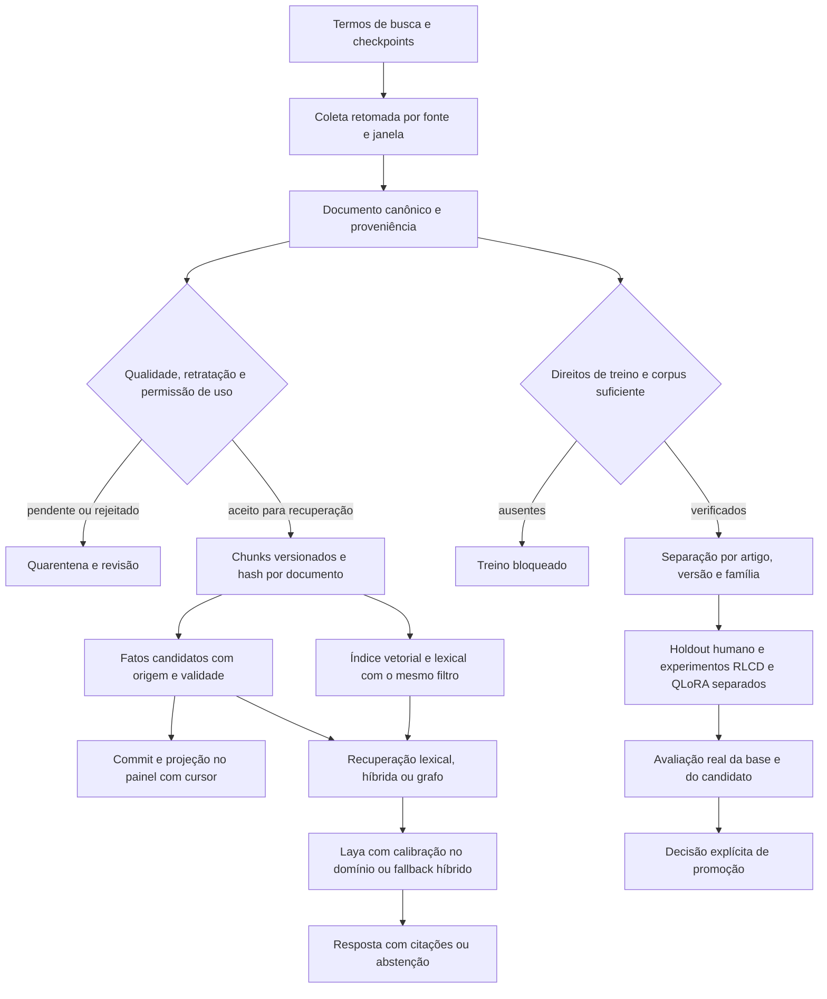

# Revisão do fluxo com os dados de D:/MongoDB

Updated: 2026-10-15. Owner: codenavi-agent. Inherits root AGENTS.md and its lifecycle.
Entry point: [MCP](../../README.md). Escopo: revisão; nenhuma migração, escrita MongoDB, inferência, coleta externa ou treino executado nesta missão.

Estado posterior: o usuário autorizou a aplicação, e as correções de código R1–R6 foram implementadas. Consulte [correções aplicadas e verificação](APPLIED.md). Os achados abaixo descrevem o snapshot original da revisão.

## Resultado

A base `DiabeticJev` está na etapa de corpus coletado/chunk preparado. Ainda não há evidência de indexação vetorial, extração de grafo, treino ou avaliação nessa base. O próximo trabalho é recuperar a coleta interrompida e validar a evidência antes de alimentar essas etapas. Os checkpoints técnicos RAG/Laya do MCP pertencem a outra base de experimentos e não demonstram desempenho biomédico.

| Evidência observada | Estado na leitura |
|---|---|
| `documents` / `chunks` | 1 / 1 |
| `search_terms` | 3.560 termos, 13 idiomas; não são documentos |
| Documento | aceito pelo gate; título + resumo de 74 caracteres; sem texto completo |
| Direitos | `is_open_access=true`, licença ausente; treino bloqueado até verificar direitos |
| Disponibilidade | `indexed=false`, `embedded=false`, `graph_extracted=false` |
| Grafo | 0 entidades, 0 relações, 0 snapshots de comunidades |
| Treino / avaliação | 0 amostras, execuções, probes, modelos e resultados |
| Coleta | 1 execução `interrupted`; 32 jobs registrados; 1 registro ingerido |
| Progresso | 3 linhas `done/exhausted`, todas com 0 registros |
| Integridade | hash do chunk confere; referência ao documento válida; limites válidos |

O hash é `SHA256(document_id + ':' + chunk.text)`, conforme `application/scraping/ingest.py:266`. Os offsets se referem ao corpo antes de o chunker unir frases com espaços; a comparação normalizada confere. Comparar o hash apenas com o texto ou exigir igualdade literal com uma fatia do resumo produziria falsos alarmes. Não foi observado chunk órfão nem corrupção nesse registro.

Os 92.011 `skipped` da coleta misturam incompatibilidade de fonte/idioma, fontes independentes de termos e retomadas já concluídas (`application/scraping/orchestrator.py:374`). Não representam 92.011 artigos obtidos. Contagens estáveis antes/depois são uma checagem de deriva; as leituras entre coleções não constituem um snapshot transacional.

## Fluxo revisado



### Ordem executável e gates

1. **Reconciliar a execução interrompida.** Conferir processo atual, janela, fonte e checkpoint antes de retomar; não usar `errors=0` como prova de conclusão. Separar `skipped_incompatible`, `skipped_resume` e `skipped_term_independent`.
2. **Validar corpus e permissões.** Preservar `_id`, DOI/PMID quando existentes, versão, hash, origem e status do gate. Este resumo permite apenas uma checagem funcional pequena; não sustenta extração de evidência clínica robusta ou avaliação de multi-hop.
3. **Aplicar o mesmo predicado em todas as rotas.** Verificar o documento pai e seu estado atual na indexação, BM25, busca vetorial e grafo. Revogação/retratação deve remover ou invalidar evidência já derivada. Corrigir primeiro R1/R2 no relatório de segurança.
4. **Indexar e extrair com estados separados.** Confirmar existência dos IDs no armazenamento vetorial antes de afirmar prontidão. `index_pending_chunks` marca chunks, mas não marca `documents.indexed`; reconciliar esse contrato. `graph_extracted=true` significa processamento concluído, podendo haver zero fatos; mostrar contagens e falhas separadamente.
5. **Integrar MongoDB ao MCP por contrato explícito.** Atualmente não há conector MongoDB: as 14 ferramentas usam o catálogo técnico/SQLite/Graphiti. Mapear documento/versão/origem antes de criar uma projeção; não rotular o resumo biomédico como fonte técnica Laya nem confundir MongoDB com os arquivos do Neo4j. Reusar o SSE do MCP depois de confirmar a projeção; garantir replay/idempotência quando houver integração.
6. **Avaliar antes de treinar/promover.** Não importar os 3.560 termos como amostras de conhecimento. Bloquear treino com licença ausente, famílias insuficientes ou holdout ausente. Não usar acurácia sintética técnica para calibrar decisões biomédicas. Eliminar a promoção baseada em smoke e constantes, separar `eval` do treino e medir respostas reais em exemplos revisados.

## Achados e prioridade

| ID | Prioridade | Achado | Evidência / ação |
|---|---|---|---|
| R1 | Alta | BM25 ignora `where` e não revalida gate do documento pai | `retriever.py:36,48`; aplicar filtro comum antes e depois da fusão |
| R2 | Alta | Extração de grafo seleciona documentos pendentes sem exigir aceitação | `graph_service.py:78`; impedir entrada de rejeitados/retratados e invalidar derivados |
| R3 | Alta | Promoção usa métricas smoke/constantes; treino real pode retornar smoke após falha | `continual.py:15,37`; `trainer.py:106`; falhar explicitamente e exigir avaliação real |
| R4 | Alta | SFT seleciona `train` e `eval`; probes derivam do mesmo artigo | `trainer.py:108`; `dataset.py:20,55`; separar artigos/famílias antes de gerar exemplos |
| R5 | Alta | Aceitação de evidência é usada no dataset sem gate explícito de direitos | `dataset.py:20`; `evidence_gate.py:55`; resolver licença antes de treino |
| R6 | Média | Flags de prontidão divergentes e consulta de título apresentada como avaliação | `indexer.py:13`; `eval/suite.py:12`; reconciliar estados e rotular smoke |

Esses pontos são achados no código local inspecionado do `DiabeticsresearchJEV`; não são falhas demonstradas do serviço MCP nem prova de que esse checkout gerou cada registro atual. Quatro reproduções isoladas confirmaram os caminhos R1/R2/R3/R4 sem acessar modelos ou alterar a base. O único documento observado está aceito; não houve reprodução de exposição de um registro real rejeitado. Correções no projeto de origem permanecem recomendações desta revisão.

## Verificação e reprodução

Consulta real feita pelo `mongosh` já instalado, usando somente `find`, `countDocuments`, agregações sem `$out/$merge` e metadados de índices. Projeções/tempo máximo seguem a [documentação oficial de find](https://www.mongodb.com/docs/manual/reference/method/db.collection.find/). Uma sequência de leituras não substitui os níveis de consistência documentados em [read concern](https://www.mongodb.com/docs/manual/reference/read-concern/).

Na pasta do MCP, para repetir a inspeção de leitura:

```powershell
& 'D:\MongoDB\mongosh\bin\mongosh.exe' 'mongodb://127.0.0.1:27017/?directConnection=true&serverSelectionTimeoutMS=5000&appName=CodENaviReadOnlyReview' --quiet --file scripts/review_mongodb.js
```

O script emite somente agregados; não altera coleções nem exporta documentos, títulos, autores ou textos. Usa `DiabeticJev` por padrão, limites de 1.000 documentos/10.000 chunks e `maxTimeMS=5000`. Autenticação, se necessária, pertence ao provedor de runtime; não inserir credenciais no script/relatório. A identidade usada nesta inspeção não foi certificada como uma role MongoDB restrita a leitura; a restrição está nas operações executadas.

Evidências: [agregados reais](evidence.json), [reproduções controladas e hashes dos métodos](reproductions.json), [verificação da revisão](verification.json), [segurança](rag-security-report.md), [dependências](dependency-vulnerability-report.md), [exposição de dados](data-exposure-report.md), [ações de correção](hardening-recommendations.md). Não foi executado scanner de CVEs, inferência biomédica ou alteração do projeto de origem.
